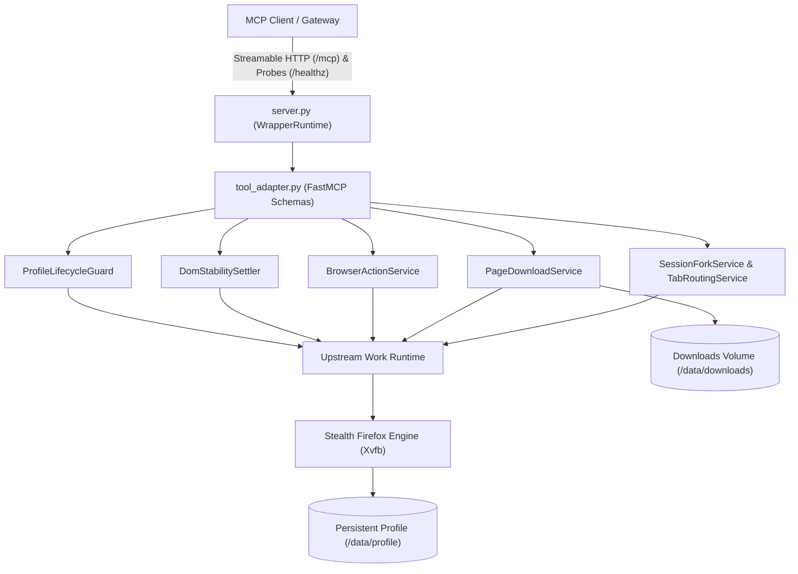
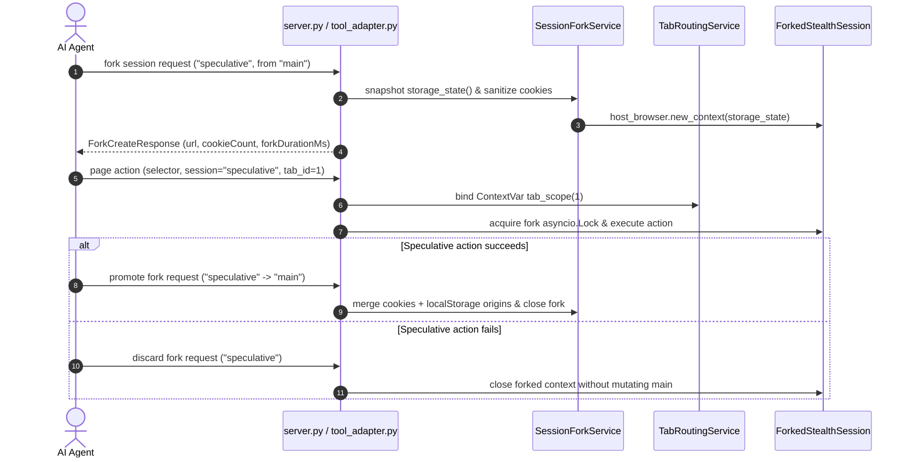

# Architecture: playwright-invisible-mcp

This document details the system topology, modular boundaries, request flows, and operational guarantees of **`playwright-invisible-mcp`**.

---

## High-Level System Architecture

---

## Request & Fork Sequence Flow

---

## Modular Boundaries & Structure

| Module | Responsibility | Guarantees |
| :--- | :--- | :--- |
| [`server.py`](src/stealth_wrapper/server.py) | Non-side-effecting runtime assembly, `/healthz` & `/health` probes, Uvicorn/stdio entrypoint. | Cleanly builds and restores FastMCP + Starlette ASGI state without import-time browser spawns. |
| [`tool_adapter.py`](src/stealth_wrapper/tool_adapter.py) | Relaxes upstream `browser` `Literal` parameters to `FlexibleBrowser` and injects `tab_id` routing. | Preserves upstream schemas while enabling fork IDs and per-call tab isolation. |
| [`models.py`](src/stealth_wrapper/models.py) | Shared Pydantic response models, cookie sanitization, and bounded text slicing. | Zero raw string replacement; deterministic pagination metadata and cookie sanitization. |
| [`profile_lifecycle_guard.py`](src/stealth_wrapper/profile_lifecycle_guard.py) | Docker symlink lock sanitization, idempotent opens, and auto-open guards. | Clears foreign container locks; blocks rogue launches for unknown fork IDs. |
| [`dom_stability_settler.py`](src/stealth_wrapper/dom_stability_settler.py) | Bounded SPA stability settling after navigation and URL-changing clicks. | Maps `networkidle` to `load`; caps polling duration so background sockets never stall callers. |
| [`browser_action_service.py`](src/stealth_wrapper/browser_action_service.py) | Scoped snapshots, `isTrusted` clipboard paste, directional scroll, bounded text/HTML reads. | Serializes X11 clipboard page access via `_clipboard_lock` (`isTrusted: true`). |
| [`page_download_service.py`](src/stealth_wrapper/page_download_service.py) | `HttpOnly` cookie inspection and authenticated browser file downloads. | Enforces download directory containment and flags anti-bot stealth HTML comment blocks as HTTP 403. |
| [`tab_routing_service.py`](src/stealth_wrapper/tab_routing_service.py) | Monotonic per-session tab IDs, pinned active tabs, and async `ContextVar` tab scopes. | Keeps closed indices tombstone-stable so active tab IDs never shift unexpectedly. |
| [`session_fork_service.py`](src/stealth_wrapper/session_fork_service.py) & [`forked_session.py`](src/stealth_wrapper/forked_session.py) | `storage_state` context cloning, shared host browser management, promote/discard workflows. | Each fork uses an independent `asyncio.Lock` with zero contention on `main`. |
| [`tool_trace_recorder.py`](src/stealth_wrapper/tool_trace_recorder.py) | Per-call JSONL telemetry, 2/3-step sequence n-gram aggregation, and streamlining opportunity detection. | Redacts sensitive arguments, bounds ring-buffer memory, and exposes `browser_trace_summary` + `GET /traces`. |
| [`credential_access_service.py`](src/stealth_wrapper/credential_access_service.py) & [`mcp_prompts.py`](src/stealth_wrapper/mcp_prompts.py) | Human-gated Vaultwarden Agent Access (`aac` + ntfy) credential injection, built-in MCP prompts, resources, and server instructions. | Injects username/password/TOTP via real keyboard events without returning secrets to the LLM or trace logs. |

---

## Non-Functional Requirements & Design Guarantees

1. **Modularity Cap**: Every source and test file remains strictly `≤ 500` lines with zero `*Manager`/`*Helper`/`*Util`/`*Data` class names.
2. **Concurrency Safety**: Independent per-session `asyncio.Lock` instances prevent cross-fork lock contention, while `ContextVar` isolates concurrent tab scopes.
3. **Path & Input Security**: Download paths resolve strictly inside `STEALTHFOX_DOWNLOADS_DIR`, and JavaScript evaluation blocks untrusted DOM mutations.
4. **Release Synchronization**: Lockstep manifest synchronization covers `pyproject.toml`, `manifest.json`, `server.json`, and `CHANGELOG.md` via `release-please`.
